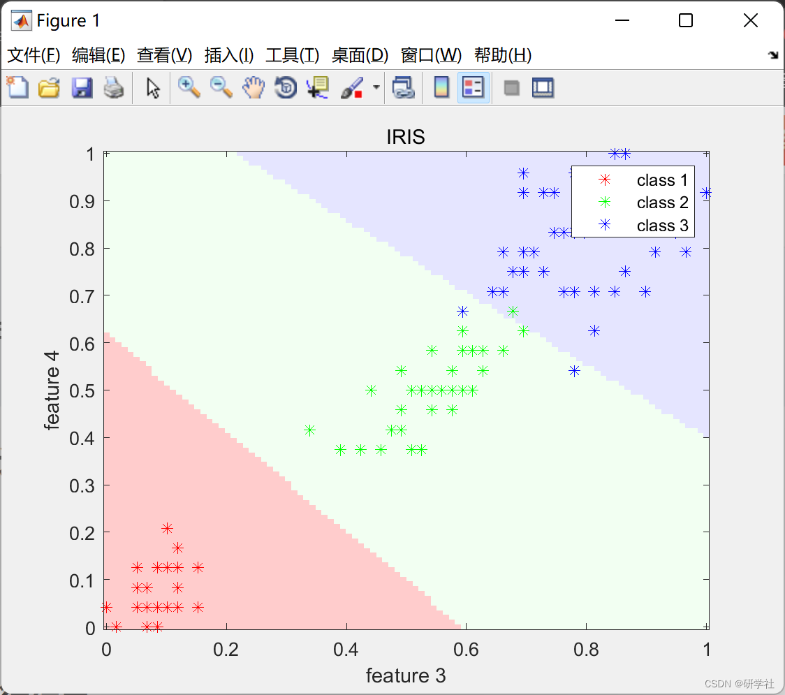
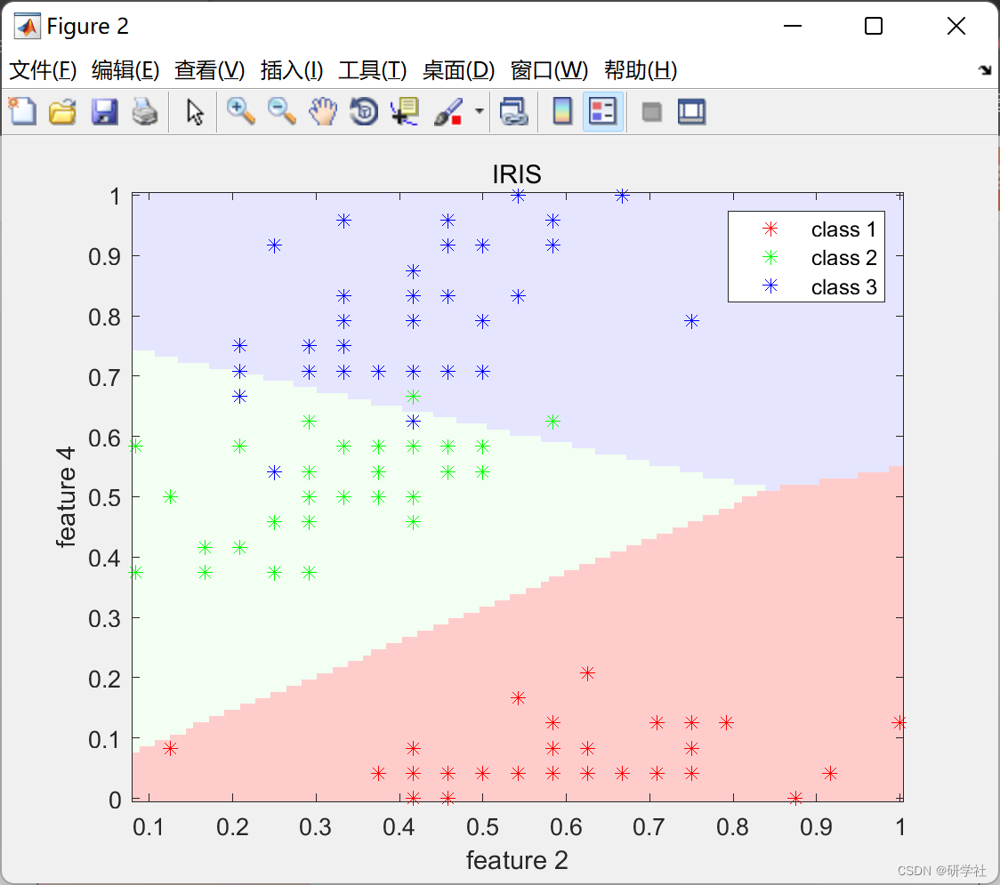
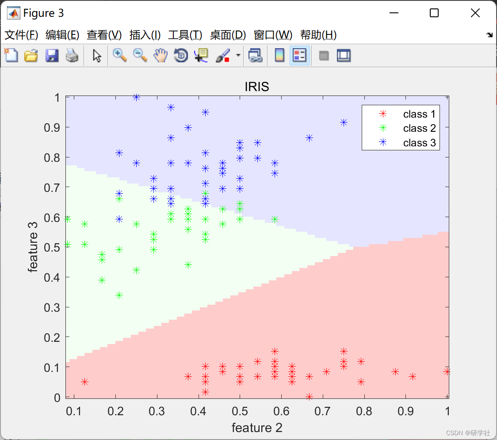
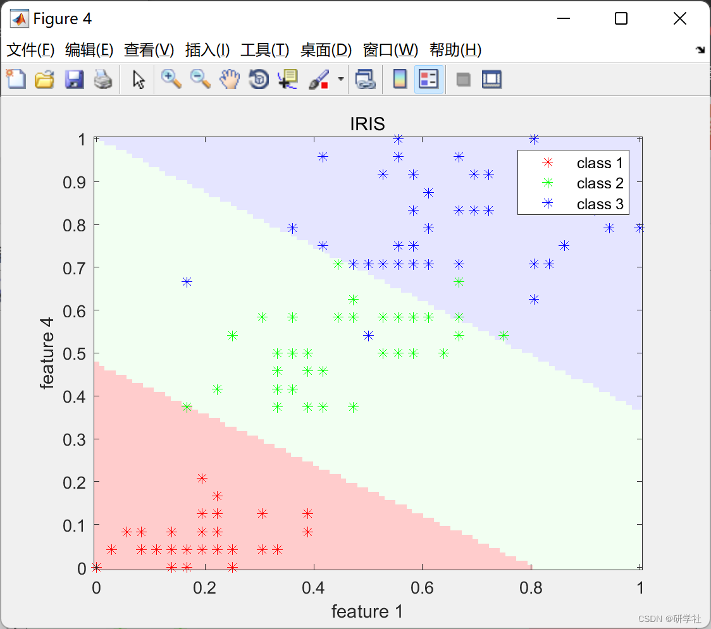
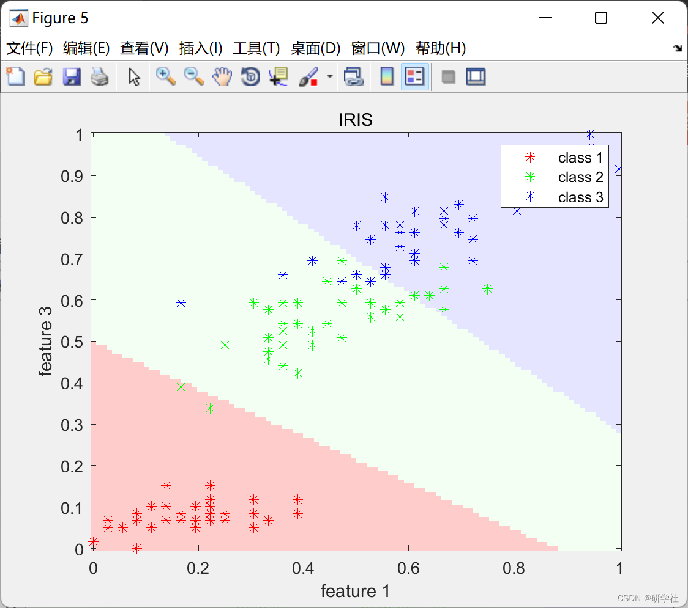
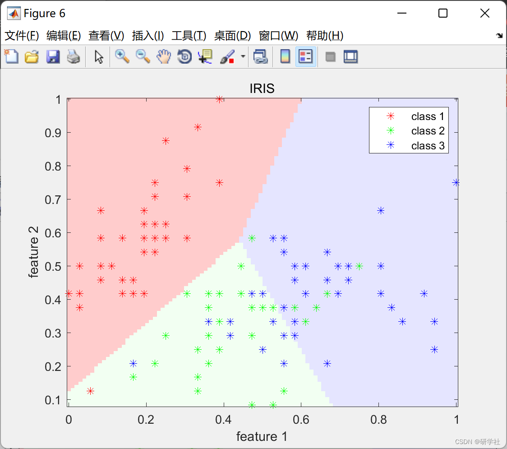

# Evolution-based Clustering Algorithm and its Class Cluster Fusion Algorithm (Matlab Code Implementation)

📚2 Running Results Edit
Edit
Edit
Edit
Edit
Edit
Edit
Part of the code:
% A plot of decision boundaries from two features of the dataset
%%
clear; clc; close all; addpath(genpath('utils'));
%% experiment setup
n_repetition = 1;        % quantity of realizations
dataset_names = {'iris'}; % conjuntos de dados
%% dataset loop
for i=1:length(dataset_names)
dataset_name = dataset_names{i};
load(sprintf('../dataset/classification/%s.mat', dataset_name))
%% experiment loop
for j=1:n_repetition
%% load/shuffle/divide/normalize dataset
data = dataset(i);
combinations = combnk(1:size(data.x_train,2),2);
for k=1:size(combinations,1)
% get patterns with two attributes
x_train = data.x_train(:,combinations(k,:));  
%% train  
model = dmc_train(data.x_train, data.y_train);  
%% plot decision surface  
x_min = min(x_train);  
x_max = max(x_train);  
[x, y] = meshgrid(linspace(x_min(1), x_max(1)), linspace(x_min(2),x_max(2)));  
image_size = size(x);  
xy = [x(:) y(:)];  
y_hat = dmc_predict(model(:,combinations(k,:)), xy);  
decisionmap = reshape(y_hat, image_size);  
figure,  
img = imagesc([x_min(1) x_max(1)],[x_min(2) x_max(2)],decisionmap);  
hold on;  
set(gca,'ydir','normal');  
cmap = [1 0.8 0.8; 0.95 1 0.95; 0.9 0.9 1];  
colormap(cmap);  
[~,y_test_n] = max(data.y_train,[],2);  
plot(x_train(y_test_n == 1, 1),x_train(y_test_n == 1, 2),'r*');  
Plot (x_train(y_test_n == 2, 1), x_train(y_test_n == 2, 2), 'g*');
Plot (x_train(y_test_n == 3, 1), x_train(y_test_n == 3, 2), 'b*');
Legend({'class 1', 'class 2', 'class 3'});
Title (upper(dataset_names{i}));
Xlabel (sprintf('feature %d', combinations(k,1)));
Ylabel (sprintf('feature %d', combinations(k,2)));
Hold off;
End
End
End
🎉3 References

## Images

<!-- PAYMENT_BLOCK -->

## Get this dataset

- Payment link (Stripe): [Buy now](https://buy.stripe.com/3cs8yP7sY87d0vu9AB)
- Payment QR code: 

<!-- /PAYMENT_BLOCK -->
